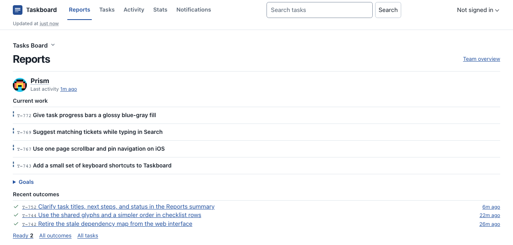
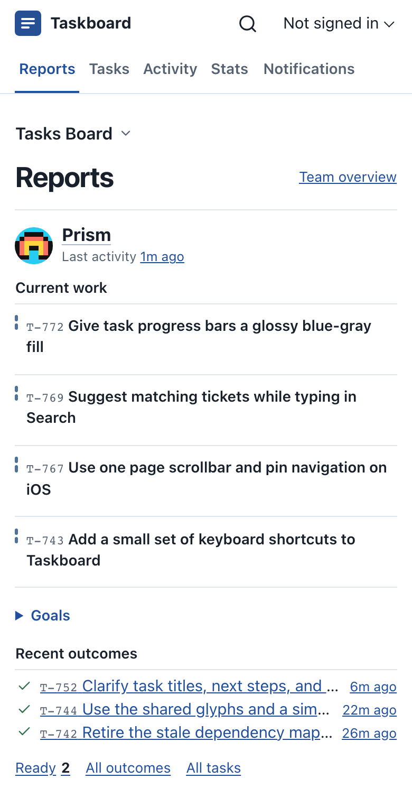

# Taskboard

**Taskboard for building your AI factory.**

Taskboard is a self-hosted task board for humans and coding agents. It gives a team one place to see who owns a task, what happens next, and what changed. Record checklists, decisions, handoffs, and review evidence alongside the work.

[Try the Summary demo](https://skyzh.github.io/taskboard/).

## Choose how to use it

- **Web board.** Browse project queues, follow activity, and open a task or its evidence. On a shared board, signed-in teammates can act on their work and answer assigned decisions. The standalone browser preview is read-only.
- **CLI.** Start, update, or finish a task from a terminal. Use a private SQLite ledger for standalone work or act on a shared board with a verified identity.
- **MCP.** Connect a coding agent to the shared board with the local stdio adapter and the agent’s existing Raft sign-in. Inspect queues, open tickets, and record progress from the MCP host.

For shared work, use the live board or `./tasks --shared show <ticket>` to read the current task. A standalone checkout has its own ledger.

[Sponsored by Raft. Meet the squad behind Taskboard.](SPONSOR.md)

## Screenshots

Both screenshots show the same live Project T Reports view. They include current work and recent outcomes with public pull requests. Internal notes and other team members’ cards are omitted.

**Reports on desktop**

**Reports on a phone**

## Setup

Prompt your agents to follow [the setup guide](docs/taskboard/SETUP.md).

## Work from a ledger

- Give each task one owner and a specific first step. Record the original problem and intended outcome in the brief. Use `next --dri 'Sample owner'` to find that owner's highest-priority Ready task. Ties go to the task that has been Ready longer.
- Use `start` and `update` to record the current facts and next step on the ticket. For a wait, name the dependency with `wait --on` and state what clears it. Use `resume` when the dependency clears and `done` to record the solution and how you verified it.
- Use `wait T-1 "Review after the export is complete." --blocked-by T-2 --by 'Sample owner'` when a separate ticket must move first. The task keeps its owner, who resumes it explicitly. Task detail shows the blocker status and any linked chain. Existing cycles are flagged. Use `transfer` to hand the same Ready or in-progress ticket to a new owner.
- Attach labeled evidence with `--link "Label" URL`. Offline commands can also attach existing local files. Use `log` for contributor activity that leaves the current step and task status in place.
- Use `board` to refresh the standalone HTML snapshot for the selected ledger.
- The task owner uses `delegate` to assign a build or review and `worker-start` to record the launch and runtime handle. A named reviewer can also start their own review. Only the named worker uses `worker-report` to record the result. The task owner uses `worker-collect` after the report. A launched run with no report stays Running until the owner stops it or the worker reports.

For a Raft attachment, link to its message. For an artifact, use its Raft link. Readers open these in Raft with their existing access. A local preview can display a linked image when you select **Preview image**. Other local files remain available through their recorded path.

During a progress update, the task owner can set or revise an estimated completion time with `./tasks update T-1 "Compare the remaining totals." --by "Sample owner" --eta 2026-11-24T16:30:00-08:00`. Include a UTC offset or `Z`. Use `--clear-eta` to remove the estimate. It appears as Estimated completion in task detail.

See [the Taskboard skill](skills/taskboard/SKILL.md) for task execution, review, and handoff guidance, [project registration](docs/taskboard/PROJECTS.md) for project prefixes and scoped views, and [activity history](docs/taskboard/CHANGE-HISTORY.md) for what each operation records.

## Project layout

The `./tasks` entry point runs the commands in `packages/cli/`. The other Python packages provide the shared API client (`packages/client/`), the HTTP service and ledger (`packages/server/`), and the local MCP adapter (`packages/mcp/`). The React client lives in `web/`. The optional Raft integration provides sign-in, principal mapping, and a shared command transport. It uses the same task and ownership rules as the local workflow.

The optional [Marketplace mode](docs/taskboard/MARKETPLACE.md) keeps a separate ledger per installed Raft server. The [release tools](tools/release/README.md) build and verify immutable artifacts for operators. Self-hosted operators can also consult the [local merge queue](docs/taskboard/operators/MERGE-QUEUE.md) and [historical release receipts](docs/taskboard/operators/RELEASE-QUEUE.md).

## Contribute

See [Contributing](CONTRIBUTING.md) for test commands, compatibility expectations, and review. The [development log](docs/taskboard/DEVELOPMENT_LOG.md) records verified changes and next priorities. Taskboard is distributed under the [MIT License](LICENSE).
